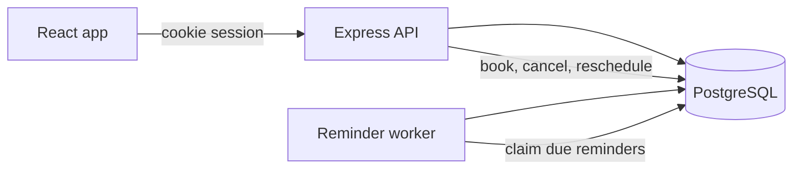

# ThoughtFull — Session Booking with Reminders

Members discover mental health professionals, book 50-minute sessions from weekly hours, and both people receive in-app reminders. Professionals publish their week and see only their own schedule.

This is a take-home implementation. All seed data is fictional.

## Technology stack

- Frontend: React, TypeScript, Vite, Tailwind CSS, React Router, TanStack Query, React Hook Form, Zod, Axios, Lucide
- Backend: Node.js, Express, TypeScript, Prisma, JWT in an HTTP-only cookie, bcrypt, Zod, Luxon
- Database: PostgreSQL 16, including GiST exclusion constraints
- Worker: a second Node process that polls PostgreSQL
- Tests: Vitest, Supertest, React Testing Library, Playwright
- Local runtime: Docker Compose

## Prerequisites

- Node.js 22
- npm 10 or newer
- Docker with Compose

## Architecture

The browser talks only to the API. The API and the worker share PostgreSQL. Slots are calculated when requested. Bookings, reminders, and notifications are rows.



A booking writes one session and up to four reminder rows inside a transaction. The worker later claims due reminders with `SELECT … FOR UPDATE SKIP LOCKED`, inserts one notification, and marks the reminder delivered. Cancellation and rescheduling update that same session and its reminders in one transaction.

## Folder structure

```text
backend/src/domain        slot generation, timezones, reminder copy
backend/src/services      booking, auth, availability, worker
backend/src/routes        HTTP adapters and Zod schemas
backend/prisma            schema and SQL migrations
frontend/src/pages        member and professional screens
frontend/e2e              Playwright booking flow
docker/init-db.sql        also creates the test database
```

## Installation

```bash
npm install
npm install --prefix backend
npm install --prefix frontend
cp .env.example backend/.env
```

## Environment variables

See `.env.example`. The values that matter locally:

| Variable | Purpose |
| --- | --- |
| `DATABASE_URL` | PostgreSQL connection string |
| `JWT_SECRET` | HMAC secret, at least 16 characters |
| `COOKIE_SECURE` | `true` only behind HTTPS. Leave `false` for local HTTP |
| `CORS_ORIGIN` | Browser origin allowed to send cookies |
| `SESSION_DURATION_MINUTES` | Always 50 for this assignment |
| `SLOT_INTERVAL_MINUTES` | Grid spacing. Default 60, which leaves a 10-minute buffer |
| `SEED_ON_START` | `true` in Docker so the first boot loads demo accounts |

## Database

PostgreSQL is published on host port 5432. If another Postgres is already using that port, start the container with `POSTGRES_PORT=5433 docker compose up -d postgres` and point `DATABASE_URL` and `TEST_DATABASE_URL` at port 5433.

Start PostgreSQL, apply migrations, then seed:

```bash
docker compose up -d postgres
npm run db:migrate
npm run db:seed
```

`docker/init-db.sql` creates `thoughtfull_test` the first time the volume is empty. Migrations live in `backend/prisma/migrations`. Use `prisma migrate deploy`. Do not use `prisma db push`; it would drop the exclusion constraints.

## Local development

API on port 4000, worker beside it, Vite on port 5173 with `/api` proxied to the API:

```bash
npm run dev
```

Open http://localhost:5173.

## Docker

```bash
docker compose up --build
```

Open http://localhost:8080. Compose starts PostgreSQL, the API (migrate, then listen, and seed when `SEED_ON_START=true`), the worker, and nginx. nginx proxies `/api` to the API so the cookie stays on one origin.

If port 8080 is already taken, set `WEB_PORT` to a free port. Compose uses that port for nginx and for `CORS_ORIGIN`:

```bash
WEB_PORT=8081 docker compose up --build
```

## Tests

One command, from the repository root. PostgreSQL must already be running, with `thoughtfull_test` available:

```bash
npm test
```

That runs the backend suite (migrations, then Vitest), the frontend unit tests, and the Playwright booking flow.

Pieces:

```bash
npm test --prefix backend
npm test --prefix frontend
npm run test:e2e --prefix frontend
```

## API overview

Responses are `{ data }` or `{ data, meta }`. Errors are `{ error: { code, message } }`.

Mutating requests send the `X-CSRF-Token` header. `GET /api/auth/csrf` returns the token. The session cookie is `tf_session` and is HTTP-only.

| Method | Path | Who |
| --- | --- | --- |
| POST | `/api/auth/register`, `/api/auth/login` | public |
| POST | `/api/auth/logout` | signed in |
| GET, PATCH | `/api/auth/me` | signed in |
| GET | `/api/professionals`, `/api/professionals/:id`, `/api/professionals/:id/slots` | signed in |
| GET, PUT | `/api/availability/me` | professional |
| POST | `/api/sessions` | member |
| GET | `/api/sessions/my-sessions` | signed in, own rows only |
| GET | `/api/sessions/:id` | a participant |
| PATCH | `/api/sessions/:id/cancel` | the member or the professional |
| PATCH | `/api/sessions/:id/reschedule` | the member |
| GET | `/api/notifications`, `/api/notifications/unread-count` | signed in |
| PATCH | `/api/notifications/:id/read`, `/api/notifications/read-all` | the owner |

Register and login return `{ data: { user } }`. `GET /api/auth/me` returns the user as `data`.

## Demo credentials

Password for every seeded account: `Thoughtfull123!`

| Email | Role | Timezone |
| --- | --- | --- |
| member@thoughtfull.test | Member, Anika Sharma | Asia/Kolkata |
| sarah.chen@thoughtfull.test | Professional | Asia/Singapore |
| james.okonkwo@thoughtfull.test | Professional | Europe/London |
| priya.nair@thoughtfull.test | Professional | Asia/Kolkata |
| elena.vargas@thoughtfull.test | Professional | America/New_York |
| rahul.mehta@thoughtfull.test | Professional | Asia/Dubai |

The seed does not overwrite an existing Anika account, so a later restart keeps data you changed.
